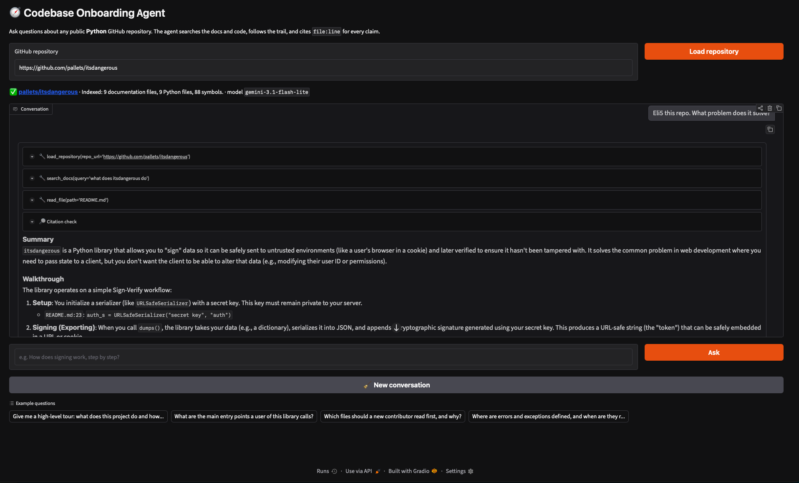
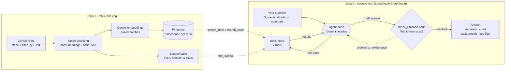
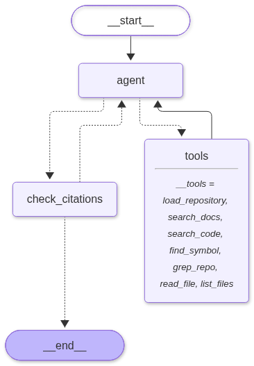
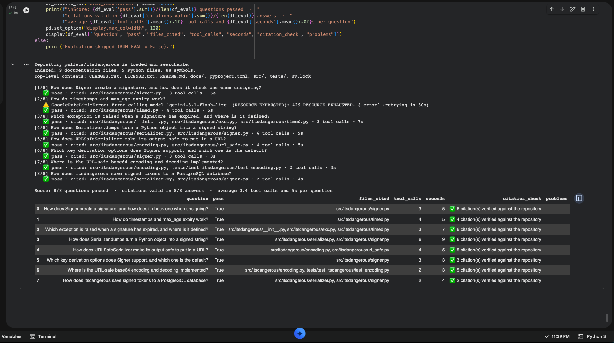

# 🧭 Codebase Onboarding Agent

[](https://codebase-app-agent-xafqjmzxpga43vvrsckbj7.streamlit.app/)
[](https://colab.research.google.com/github/jvs867/codebase-onboarding-agent/blob/main/Codebase_Onboarding_Project1-sears.ipynb)

```python
ask("How does signing work, step by step?",
    repo_url="https://github.com/pallets/itsdangerous")
```

That one call is the whole project. Point it at any public Python repo on GitHub, ask a question in plain English, and a LangGraph agent goes digging: it searches the docs and code by meaning (RAG over a Pinecone vector database), follows function calls from file to file, and backs every claim with a `file:line` citation. Each citation gets checked against the real repo and turned into a GitHub link.

You don't need to write code to use it. Pick whichever fits:

| Way to use it | What you need |
| :--- | :--- |
| [Hosted Streamlit app](https://codebase-app-agent-xafqjmzxpga43vvrsckbj7.streamlit.app/) | A browser |
| Streamlit app on your computer (`app.py`) | Python and two free API keys |
| Google Colab notebook (includes the evaluation) | A Google account and two free API keys |

Same agent behind all three. New to words like RAG or embedding? There's a glossary at the end.

*Built for Codecademy's Building Agentic AI Applications bootcamp, with Satyajit Pattnaik, Fall 2026 (Contest #1).*



*The notebook's Gradio UI. The Streamlit app shows the same tool steps, citation check and answer.*

## How it works



### Step 1: indexing (once per repo)

```python
tree = ast.parse(source)
for node in tree.body:          # one chunk per function, class, method
    ...
```

The knowledge base is a whole repo: docs and source code together. Before the agent can search it by meaning, it has to be cut up and stored. `prepare_repository()` does that:

1. Clone the repo.
2. Filter: keep `.py` files and docs, skip tests, build folders and huge files.
3. Chunk: docs get cut at headings. Code gets cut with Python's own `ast` module, as above, so a function never ends up sliced in half. The same pass builds a symbol table of where everything is defined.
4. Embed each chunk with `gemini-embedding-001`, paced to stay under the free plan's limit.
5. Store the embeddings in a Pinecone serverless index, one namespace per repo, so they persist between sessions.

A repo that's already indexed skips steps 4 and 5, and an interrupted upload picks up where it stopped.

### Step 2: answering (every question)

```python
builder.add_edge(START, "agent")
builder.add_conditional_edges("agent", route_after_agent, ["tools", "check_citations"])
builder.add_edge("tools", "agent")
builder.add_conditional_edges("check_citations", route_after_check, ["agent", END])
```

Those four lines are the agent's whole control flow: a LangGraph `StateGraph` with three nodes. A basic RAG chatbot searches once and answers. This one loops: `agent` keeps calling `tools` until it's ready to answer, then `check_citations` gets the last word.

| Node | What it does |
| :--- | :--- |
| `agent` | Gemini decides: call tools, or write the answer. Backup models step in on errors. |
| `tools` | Runs the tools it asked for and hands back the results. |
| `check_citations` | Checks that every cited file and line range really exists. A bad answer goes back once for a rewrite. |



The agent has seven tools to call:

| Tool | Type | What it does |
| :--- | :--- | :--- |
| `load_repository` | Setup | Clones and indexes a repo (Step 1). |
| `search_docs`, `search_code` | RAG | Search docs or code by meaning. |
| `find_symbol` | Navigation | Jumps to a function or class definition. |
| `grep_repo` | Navigation | Exact text search, like Ctrl+F. |
| `read_file` | Navigation | Reads specific lines of a file. |
| `list_files` | Navigation | Shows the folder structure. |

`SYSTEM_PROMPT` tells the agent to act like a senior engineer: never guess, start with the docs, then trace the code. Answers come back as a summary, a cited walkthrough and a list of key files. `MAX_TOOL_CALLS = 15` stops it from wandering, and a checkpointer remembers the conversation so follow-ups work.

## Files

| File | What it is |
| :--- | :--- |
| `app.py` | The Streamlit app: the whole project in one file. |
| `Codebase_Onboarding_Project1-sears.ipynb` | The Colab notebook: same code, a Gradio UI, and the evaluation. |
| `requirements.txt` | The packages you need. |
| [`Project Report.pdf`](Project%20Report.pdf) | Design, results and challenges. |

## Setup

Options B to D need two free API keys: [Google AI Studio](https://aistudio.google.com/apikey) (Gemini) and [Pinecone](https://app.pinecone.io).

A. Hosted app. Just open the [live link](https://codebase-app-agent-xafqjmzxpga43vvrsckbj7.streamlit.app/). If it's asleep, click the wake-up button.

B. On your computer. You need Python 3.10–3.13 and `git`.

```bash
git clone https://github.com/jvs867/codebase-onboarding-agent.git
cd codebase-onboarding-agent
python3.12 -m venv .venv
source .venv/bin/activate          # Windows: .venv\Scripts\activate
pip install -r requirements.txt
export GOOGLE_API_KEY="..." PINECONE_API_KEY="..."   # or paste them in the app's sidebar
streamlit run app.py
```

C. Colab notebook. Click Open in Colab, add `GOOGLE_API_KEY` and `PINECONE_API_KEY` under Secrets (🔑), then Runtime → Run all.

D. Host your own copy on [Streamlit Community Cloud](https://share.streamlit.io). Create an app from your fork with `app.py` as the main file. Under Advanced settings, pick Python 3.12 and paste this into Secrets:

```toml
GOOGLE_API_KEY = "..."
PINECONE_API_KEY = "..."
UI_USERNAME = "..."
UI_PASSWORD = "..."
```

Do set the login. Without it, anyone with the link can burn through your API quota. Also, a hosted app forgets chats and cloned repos when it restarts. Reloading is quick, since the embeddings are still in Pinecone.

| Setting | Purpose |
| :--- | :--- |
| `GOOGLE_API_KEY`, `PINECONE_API_KEY` | Required. Never commit them to GitHub. |
| `UI_USERNAME`, `UI_PASSWORD` | Optional login in front of the app. |

## Usage

In the Streamlit app:

1. Paste a GitHub link in the sidebar and click Load repository. The first load can take a few minutes.
2. Ask a question in the chat box, or click an example.
3. Watch it work: each tool call shows up as a step you can open, then the citation check, then the answer.

The sidebar also has New chat, Re-index and a list of indexed repos.

In the notebook:

```python
ask("Give me a high-level tour of this project.", repo_url="https://github.com/owner/repo")
ask("Walk me through how a request is handled.")   # follow-up
```

## Evaluation

```python
df = run_eval()   # 8 questions about pallets/itsdangerous
```

A good-looking demo isn't proof, so section 16 of the notebook tests the agent. Seven questions pass when the answer cites the right file and every citation is valid. The eighth is a trick question about something the library doesn't do, and it passes when the agent says so.

Result: 8/8 passed (`gemini-3.1-flash-lite`), averaging 3.4 tool calls and 5 seconds per question. The evaluation lives in the notebook only.

| Question | Files cited | Tool calls | Result |
| :--- | :--- | :---: | :---: |
| How Signer creates and checks a signature | `signer.py` | 3 | ✅ |
| Timestamps and `max_age` expiry | `timed.py` | 4 | ✅ |
| Exception raised for an expired signature | `exc.py`, `timed.py`, `__init__.py` | 3 | ✅ |
| How `Serializer.dumps` signs an object | `serializer.py`, `signer.py` | 6 | ✅ |
| How URLSafeSerializer makes output URL-safe | `url_safe.py`, `encoding.py` | 4 | ✅ |
| Signer's key derivation options and default | `signer.py` | 3 | ✅ |
| Where URL-safe base64 is implemented | `encoding.py` | 2 | ✅ |
| Saving tokens to PostgreSQL *(out of scope)* | `serializer.py`, `signer.py` | 2 | ✅ |

<details>
<summary>Evaluation output in the notebook</summary>



</details>

## Troubleshooting

| Problem | Fix |
| :--- | :--- |
| `No matching distribution found for langchain-pinecone` | Your Python is too new. Use 3.12 or 3.13 for the virtual environment. |
| Stuck on "Connecting to Gemini and Pinecone" | Start-up tests up to five models (20 seconds each). Watch the terminal. |

## Limitations

- Python repos only.
- No automatic refresh: re-index after a repo changes.
- Small evaluation: eight questions, one repo, citations only.
- One question at a time: a second user waits for the first.

## Glossary

| Term | Meaning |
| :--- | :--- |
| LLM | An AI model that reads and writes text. This project uses Google's Gemini. |
| Chunk | A small piece of a file, such as one function or one docs section. |
| Embedding | A list of numbers that represents a text's meaning. Similar meanings get similar numbers. |
| Vector database | Stores embeddings and finds the ones closest to a question. Here: Pinecone. |
| RAG | Retrieval-Augmented Generation: fetch the relevant chunks first, then let the LLM answer from them. |
| Agent | An LLM in a loop: pick a tool, look at the result, repeat until it can answer. |
| LangGraph | A library for building an agent as a graph of steps (nodes) and arrows (edges). |
| AST | Abstract Syntax Tree: Python's structured view of code, showing where each function and class starts and ends. |

## License

[MIT](LICENSE)

## AI Use
Claude was used extensively to assist in writing code for this project.
