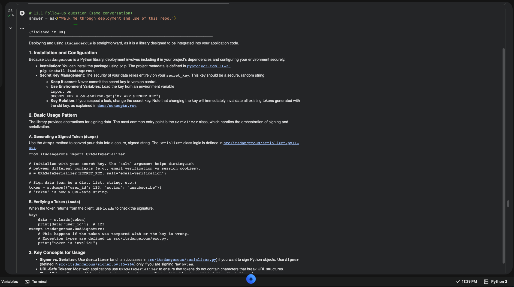
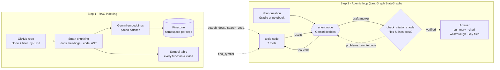

# 🧭 Codebase Onboarding Agent

[](https://colab.research.google.com/github/jvs867/codebase-onboarding-agent/blob/main/Codebase_Onboarding_Project1-sears.ipynb)

Paste a link to any public Python repository on GitHub and ask questions about it in plain English. The agent searches the docs and code by meaning (**RAG** over a **Pinecone** vector database), then explores the repo step by step (a **LangGraph** `StateGraph` agent). It follows function calls from file to file, cites the exact `file:line` behind every claim, checks each citation against the repository before answering, and links each one to those lines on GitHub.

The project covers **both** contest tracks: a RAG chatbot with a complex knowledge base and a vector database, and a LangGraph agentic workflow.

*Created as part of an assignment for Codecademy's Building Agentic AI Applications bootcamp, with Satyajit Pattnaik, Fall 2026 (Contest #1).*


<details>
<summary>Notebook run: a follow-up question with cited, linked answer</summary>



</details>

## How it works



### Step 1: indexing a repository

1. **Clone** the repository (shallow).
2. **Filter:** keep Python files and documentation; skip tests, vendored and build folders, and oversized files.
3. **Chunk:** documentation splits at headings (up to 2,000 characters, 200 overlap). Python code splits with the `ast` module into one chunk per function, method, class overview and module overview (up to 6,000 characters), so a function is never cut in half. This step also builds a symbol table of where every function and class is defined.
4. **Embed** each chunk with `gemini-embedding-001`. Requests are sized by estimated tokens, and a rate limiter keeps each rolling minute under the free tier's 30,000 tokens.
5. **Store** the vectors in Pinecone, one namespace per repository.

Already-indexed repos skip steps 4–5, and an interrupted upload resumes with only the missing chunks.

### Step 2: answering questions

The agent is a LangGraph `StateGraph` with three nodes:

| Node | What it does |
| :--- | :--- |
| `agent` | Gemini reads the conversation and either requests tool calls or writes the answer. Fallback models take over on errors. |
| `tools` | Runs the requested tools and returns the results to `agent`. |
| `check_citations` | Checks every `file:line` in the draft answer against the cloned repo (the file exists, the lines are inside it). A faulty answer goes back to `agent` once with the problems listed, e.g. *"`signer.py` does not exist (did you mean `src/itsdangerous/signer.py`?)"* |


The agent has seven tools:

| Tool | Type | What it does |
| :--- | :--- | :--- |
| `load_repository` | Setup | Clones and indexes a new repository (Step 1). |
| `search_docs` | **RAG** | Semantic search over the documentation. |
| `search_code` | **RAG** | Semantic search over the code, e.g. *"code that checks a password"*. |
| `find_symbol` | Navigation | Jumps to where a function or class is defined. |
| `grep_repo` | Navigation | Exact text or regex search across files. |
| `read_file` | Navigation | Reads specific lines of a file. |
| `list_files` | Navigation | Shows the folder structure. |

A system prompt has the agent act like a senior engineer onboarding a teammate: never guess, start with the docs and then trace the code, and answer with a summary, a numbered walkthrough citing `file:START-END`, and the key files to read first. It usually needs 4–10 tool calls; the graph enforces a hard limit of 15, after which the agent must answer from what it has found. An `InMemorySaver` checkpointer keeps each conversation for follow-up questions. The notebook draws the graph (section 9.1), and the notebook trace and web UI show the citation check as a step.

## Setup

1. Get two free API keys: [Google AI Studio](https://aistudio.google.com/apikey) (Gemini) and [Pinecone](https://app.pinecone.io) (the free Starter plan is enough; the notebook creates the index).
2. Click **Open in Colab** above, open **Secrets** (🔑 in the left sidebar) and add:

   | Secret | Required | Purpose |
   | :--- | :--- | :--- |
   | `GOOGLE_API_KEY` | yes | Gemini chat and embedding models |
   | `PINECONE_API_KEY` | yes | Vector database |
   | `UI_USERNAME`, `UI_PASSWORD` | recommended | Login for the public web UI link |

3. **Runtime → Run all.**

Missing API keys are prompted for. Without the UI secrets, anyone with the public link can use the app and your API quota. To run locally, `pip install -r requirements.txt`, set the same values as environment variables, and change `CLONE_DIR` in the configuration cell.

## Usage

**Web UI:** the notebook prints a public `gradio.live` link. Paste a GitHub URL, click **Load repository**, then chat. Each tool call appears as a collapsible step.

**Notebook:**

```python
ask("Give me a high-level tour of this project.", repo_url="https://github.com/owner/repo")
ask("Walk me through how a request is handled.")   # follow-up, same conversation
```

**Utilities:** `list_indexed_repositories()`, `reindex_repository(url)`, `delete_repository_index(url)`, `run_eval()`.

## Evaluation

Section 19 asks eight questions about [pallets/itsdangerous](https://github.com/pallets/itsdangerous), each in a fresh conversation. Seven ask about specific behavior and pass when the answer cites the file where that code lives and every citation is valid. The eighth asks about something the library doesn't do (saving tokens to PostgreSQL) and passes when the agent says so. Results are saved to `eval_results.csv`; set `RUN_EVAL = False` to skip the several-minute run.

**Result: 8/8 passed** (with `gemini-3.1-flash-lite`), with valid citations in every answer and an average of 3.4 tool calls and 5 seconds per question.

| Question | Files cited | Tool calls | Result |
| :--- | :--- | :---: | :---: |
| How Signer creates and checks a signature | `signer.py` | 3 | ✅ |
| Timestamps and `max_age` expiry | `timed.py` | 4 | ✅ |
| Exception raised for an expired signature | `exc.py`, `timed.py`, `__init__.py` | 3 | ✅ |
| How `Serializer.dumps` signs an object | `serializer.py`, `signer.py` | 6 | ✅ |
| How URLSafeSerializer makes output URL-safe | `url_safe.py`, `encoding.py` | 4 | ✅ |
| Signer's key derivation options and default | `signer.py` | 3 | ✅ |
| Where URL-safe base64 is implemented | `encoding.py` (and its test file) | 2 | ✅ |
| Saving tokens to PostgreSQL *(out of scope)* | `serializer.py`, `signer.py` | 2 | ✅ |

<details>
<summary>Evaluation output in the notebook</summary>


</details>

## Limitations

* Python repositories only.
* Indexed repos don't refresh automatically when they change upstream; use `reindex_repository(url)`.
* Very large repos are capped at `MAX_CHUNKS_PER_REPO` embedded chunks; `find_symbol`, `grep_repo` and `read_file` still cover the whole repo.
* The evaluation is small (eight questions, one repo) and checks citations, not every sentence.
* Gemini's free tier is rate-limited; the notebook falls back to other models, but heavy use may need billing.

## Project report

[Project Report.pdf](Project%20Report.pdf) covers the design, agent graph, evaluation, and challenges.

## License

[MIT](LICENSE)
